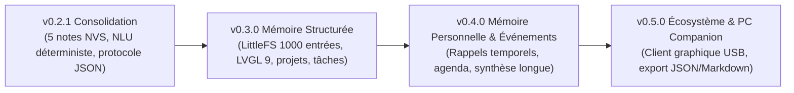

# Feuille de route VoiceJournal (Roadmap)

Ce document présente la vision d'évolution architecturale et fonctionnelle de VoiceJournal.

---

## 1. Vision générale

VoiceJournal évolue par étapes rigoureuses et consolidées :

---

## 2. Statut des versions

### [v0.2.1] — Consolidation industrielle (Terminé & Validé)
- Socle logiciel unifié, robuste et sécurisé.
- Rejet strict des entrées invalides (COR-11 à COR-15).
- 636 tests unitaires natifs C++17 à 100% de réussite.

### [v0.3.0] — Mémoire Structurée & LVGL 9 (Terminé — En attente validation physique CoreS3)
- **Mémoire structurée LittleFS** : jusqu'à 1 000 entrées avec journal append-only, validation CRC32 et indexation RAM.
- **Nouvelle interface graphique épurée sous LVGL 9** : 4 pages (Accueil, Journal, Projets, Tâches), vue Détail complète et typographie Segoe UI avec accents français.
- **Gestion des projets et des tâches** : association contextuelle (« Ouvre le projet VoiceKit »), clôture vocale et tactile des tâches.
- **Moteur de recherche multicritère local** : recherche locale sans base vectorielle ni modèle cloud.
- **Partitionnement 16 Mo Flash** : 6 Mo partition applicative (39,1% occupée), 9 Mo LittleFS, 20 Ko NVS protégée.
- **646 tests unitaires natifs C++17 réussis à 100%**.

---

### [v0.4.0] — Mémoire Personnelle Temporelle et Événements (Prochaine étape)

L'objectif de la v0.4.0 est d'introduire la gestion du temps avancée et les rappels proactifs.

#### Fonctionnalités cibles :
1. **Gestion d'événements et agenda :**
   - Activation effective de `ADD_EVENT` et `LIST_EVENTS`.
   - Extraction des plages horaires, rappels et dates absolues.
   - Alertes sonores et visuelles discrètes basées sur l'horloge RTC interne du CoreS3 (BM8563).
2. **Synthèse et rétrospective :**
   - Résumés hebdomadaires automatiques via le flux LLM.
   - Détection des tendances et des blocages récurrents dans les notes.
3. **Optimisation batterie et veille :**
   - Modes veille légère (Light Sleep) entre deux interactions tactiles/vocales pour autonomie accrue.

---

### [v0.5.0] — Écosystème & PC Companion
- Application compagnon PC (Windows / Linux / macOS) dialoguant via le protocole série JSON existant.
- Sauvegarde bidirectionnelle, synchronisation et export en formats Markdown / Obsidian / Notion.
