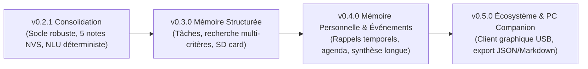

# Feuille de route VoiceJournal (Roadmap)

Ce document présente la vision d'évolution architecturale et fonctionnelle de VoiceJournal à partir de la version de consolidation **v0.2.1**.

---

## 1. Vision générale

VoiceJournal v0.2.1 établit une base industrielle consolidée :
- Un moteur contextuel déterministe C++17 ultra-rapide (< 1 ms).
- Une sécurité renforcée contre les exécutions accidentelles (COR-11, COR-12, COR-13).
- Un protocole d'échange structuré JSON sur port série USB (COR-14).
- Une architecture matérielle validée sur M5Stack CoreS3 avec double pile audio (OpenAI Realtime / Google Gemini Live) et stockage double page NVS A/B.

Les versions ultérieures développeront la **mémoire personnelle et technique** de l'utilisateur sans compromettre la réactivité, l'autonomie et la sécurité qui caractérisent le cœur VoiceJournal.

---

## 2. Versions prévues

### v0.3.0 — Mémoire Structurée et Suivi Technique

L'objectif de la v0.3.0 est d'élargir le modèle de données au-delà de la liste linéaire d'observations brutes pour intégrer la gestion des tâches techniques et la recherche fine.

#### Fonctionnalités cibles :
1. **Gestion des tâches techniques :**
   - Activation effective des intentions `ADD_TASK`, `LIST_TASKS`, `COMPLETE_TASK`.
   - Paramètres d'action, d'entité et de date relative (`demain`, `lundi`, `urgent`).
   - Statut des tâches (à faire, terminée, annulée).
2. **Recherche multi-critères :**
   - Activation effective de `SEARCH_BY_DATE` (ex. : *"Qu'ai-je noté hier ?"*).
   - Activation effective de `SEARCH_NOTES` par mot-clé ou entité (ex. : *"Cherche les notes sur la batterie"*).
3. **Analyse thématique et technique :**
   - `ANALYZE_PROJECT` (ex. : *"Fais le bilan du projet VoiceKit"*).
   - `ANALYZE_TOPIC` (ex. : *"Résume les problèmes d'alimentation"*).
4. **Extension du stockage :**
   - Migration optionnelle ou complémentaire NVS $\rightarrow$ Carte MicroSD (SPI / FATFS).
   - Dépassement de la limite de 5 observations pour supporter jusqu'à 100 observations indexées localement.

---

### v0.4.0 — Mémoire Personnelle Temporelle et Événements

L'objectif de la v0.4.0 est d'introduire la gestion du temps et la contextualisation temporelle avancée.

#### Fonctionnalités cibles :
1. **Gestion d'événements et agenda :**
   - Activation effective de `ADD_EVENT` et `LIST_EVENTS`.
   - Extraction des plages horaires, rappels et dates absolues.
   - Intégration avec la RTC interne du CoreS3 (BM8563) synchronisée par NTP.
2. **Synthèse et rétrospective :**
   - Résumés hebdomadaires automatiques via le flux LLM.
   - Détection des tendances et des blocages récurrents dans les notes.
3. **Configuration par commande vocale :**
   - Bascule du fournisseur IA à la voix (*"Bascule sur Gemini"*, *"Passe sur OpenAI"*).
   - Réglage du volume sonore et du mode de parsing vocalement.

---

### v0.5.0 — Application Compagnon PC et Outils Avancés

Exploitation native du protocole JSON unifié (COR-14) via une application de bureau.

#### Fonctionnalités cibles :
1. **VoiceJournal Desktop Companion (PC) :**
   - Visualisation temps réel du carnet et des métriques matérielles.
   - Parsing Lab graphique avec historique des analyses.
   - Outil d'injection de tests et de validation automatisée USB.
2. **Synchronisation et export :**
   - Export en 1 clic des notes vers Obsidian, Markdown, Notion ou JSON.
   - Sauvegarde et restauration des partitions NVS.
3. **Parsing multilingue :**
   - Support bilingue Français / Anglais configurable.
   - Modèles de grammaire téléchargeables via carte SD.

---

## 3. Matrice de transition des intentions

| Intention | Statut v0.2.1 | Cible v0.3.0 | Cible v0.4.0+ |
|---|---|---|---|
| `ADD_NOTE` | **Actif et exécutable** | Actif | Actif |
| `READ_LAST_NOTE` | **Actif et exécutable** | Actif | Actif |
| `COUNT_NOTES` | **Actif et exécutable** | Actif | Actif |
| `ANALYZE_NOTES` | **Actif et exécutable** | Actif | Actif |
| `REQUEST_CLEAR` / `CONFIRM_CLEAR` | **Actif et sécurisé** | Actif | Actif |
| `CANCEL_ACTION` | **Actif et exécutable** | Actif | Actif |
| `HELP` | **Actif et exécutable** | Actif | Actif |
| `ADD_TASK` | *Reconnu (expérimental)* | **Actif et exécutable** | Actif |
| `LIST_TASKS` / `COMPLETE_TASK` | *Reconnu (expérimental)* | **Actif et exécutable** | Actif |
| `SEARCH_BY_DATE` | *Reconnu (expérimental)* | **Actif et exécutable** | Actif |
| `SEARCH_NOTES` | *Reconnu (expérimental)* | **Actif et exécutable** | Actif |
| `ANALYZE_PROJECT` | *Reconnu (expérimental)* | **Actif et exécutable** | Actif |
| `ANALYZE_TOPIC` | *Reconnu (expérimental)* | **Actif et exécutable** | Actif |
| `ADD_EVENT` / `LIST_EVENTS` | *Reconnu (expérimental)* | Réservé | **Actif et exécutable** |
| `SET_AI_PROVIDER` | *Non supporté à la voix* | Réservé | **Actif et exécutable** |

---

## 4. Principes directeurs de conception future

Pour toute évolution future, les règles d'or suivantes doivent être respectées :
1. **Zéro régression sur la réactivité :** Le moteur NLU doit rester 100% embarqué sur l'ESP32-S3 et répondre en moins d'une milliseconde.
2. **Sécurité par défaut (Fail-Safe) :** Aucune action destructive ou ambiguë ne doit s'exécuter sans confirmation explicite.
3. **Isolation de VoiceKit :** Les flux audio bidirectionnels restent prioritaires. Les opérations de traitement mémoire et d'analyse NLU ne doivent jamais bloquer la boucle audio (`voiceController.update()`).
4. **Compatibilité ascendante :** Le format des trames de diagnostic JSON (COR-14) reste stable et documenté dans [SERIAL_PARSER_PROTOCOL.md](SERIAL_PARSER_PROTOCOL.md).
