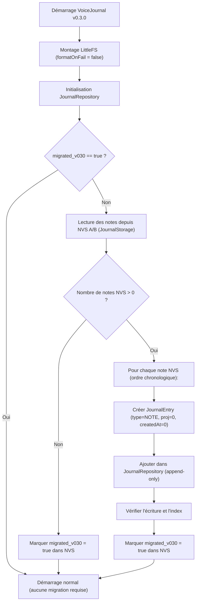

# Migration du stockage — VoiceJournal v0.2.1 vers v0.3.0

## 1. Contexte et objectifs

Dans VoiceJournal v0.2.1, les observations techniques étaient enregistrées dans un tampon circulaire NVS (Non-Volatile Storage) à double page A/B, limité à 5 chaînes de 180 octets chacune.

VoiceJournal v0.3.0 introduit une mémoire structurée sur système de fichiers **LittleFS**, capable d'accueillir jusqu'à 1 000 entrées de 1 024 octets chacune avec projets, statuts, entités et horodatage.

La migration vers v0.3.0 doit respecter impérativement les critères suivants :
1. **Automatique au démarrage** : exécutée dès le premier lancement de la v0.3.0 après montage de LittleFS.
2. **Non destructive** : les clés NVS historiques (`head`, `count`, `note0`..`note4`) sont **conservées intactes** et ne sont jamais supprimées.
3. **Idempotente** : l'opération positionne un drapeau NVS `migrated_v030 = true`. Un redémarrage ne ré-importe jamais les notes et ne crée aucun doublon.
4. **Fidélité stricte des données** :
   - Préservation intégrale du texte d'origine (accents, ponctuation, casse).
   - Préservation de l'ordre chronologique d'enregistrement.
   - Typage par défaut en `EntryType::NOTE`.
   - **Aucune invention de métadonnées** : les dates restent marquées inconnues (`0`) car la v0.2.1 ne disposait pas d'horodatage, et aucun projet n'est inventé (`projectId = 0`).

---

## 2. Processus pas-à-pas de migration



---

## 3. Implémentation technique (`StorageMigration`)

Le module [`StorageMigration`](../include/StorageMigration.h) orchestre cette transition :

```cpp
bool StorageMigration::migrateNvsToLittleFs(
    IKeyValueStore& nvs, 
    JournalStorage& legacyStorage, 
    JournalRepository& repo) 
{
    // 1. Vérification d'idempotence
    if (nvs.getBool("migrated_v030", false)) {
        return true; // Déjà migré
    }

    // 2. Lecture des notes de l'ancien carnet (jusqu'à 5)
    size_t count = legacyStorage.noteCount();
    for (size_t i = 0; i < count; i++) {
        String text = legacyStorage.getNote(i);
        if (text.length() == 0) continue;

        // 3. Conversion fidèle sans métadonnées inventées
        JournalEntry entry;
        entry.type = EntryType::NOTE;
        entry.text = std::string(text.c_str());
        entry.projectId = 0;
        entry.createdAt = 0; // Inconnu
        entry.status = EntryStatus::NONE;

        if (!repo.addEntry(entry)) {
            return false; // Échec sécurisé, le flag migrated_v030 n'est pas posé
        }
    }

    // 4. Validation et verrouillage d'idempotence
    nvs.setBool("migrated_v030", true);
    return true;
}
```

---

## 4. Garantie de non-régression et sauvegarde

- **Préservation de la table des partitions** :
  La partition `nvs` est maintenue à l'adresse exacte `0x9000` avec la taille `0x5000` (20 Ko), identique à la v0.2.1. Les données préexistantes sont donc préservées au niveau bloc sans effacement.
- **Rollback possible** :
  Si l'utilisateur décide de flasher à nouveau un firmware v0.2.1, l'application v0.2.1 retrouve ses données NVS intactes et son fonctionnement nominal sans altération.
